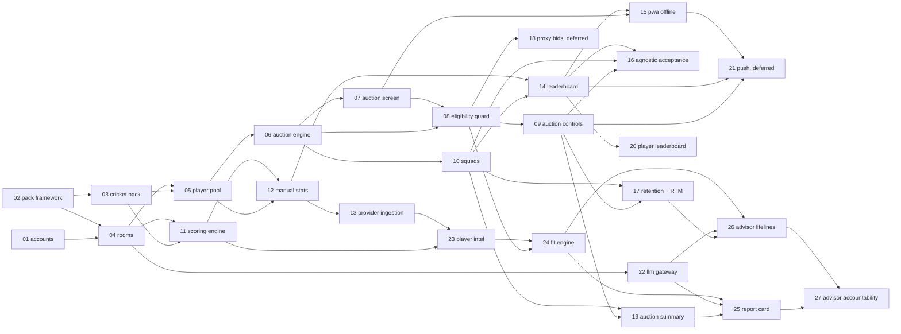

# Roadmap

Every P0 and P1 feature in `docs/PaddleUp_PRD.md`. Each row is an rx spec with a pre-seeded
`specs/<id>/state.md` (intake filled from the PRD, phase `requirements`). Every feature depends only
on features with a lower number. The order they are actually built in, and which ones run side by
side, is under [Build order](#build-order). Live progress is in each `state.md` (or `/rx:status --all`).

## Lanes

Each spec has a lane (the Lane column below). The reasons are in
`docs/knowledge/decisions/2026-11-12-tiered-lanes-quick-in-parallel.md`.

| Lane | Spec files | Gates | Review |
|---|---|---|---|
| full | `requirements.md`, `plan.md` (with options considered), `tasks.md`, `review.md` | G1, G2, G3 | qa + security |
| quick | `quick.md` (change, ACs, tasks; 30 lines) | G2 | qa |

A spec is quick when it fits `quick.md` (about 6 ACs and 8 tasks) and adds nothing with a lifetime
(session, timer, lifeline). A quick spec that overflows is moved to the full lane, not squeezed. Both
lanes write decision records at close.

## Starting a feature

The spec folder already exists, so do not run `/rx:feature` (it refuses existing ids). Instead:

1. Check its dependencies below are merged to `main`.
2. Review the intake lines in `specs/<id>/state.md` and edit them if the scope changed. Pull in work
   other specs handed over (`grep -rn "deferred to <id>" specs/*/state.md`, plus any `deferred from`
   lines already in this file), and add the answers you already know as intake lines so the pm brief
   comes back without questions.
3. UI work: check the screens against `docs/design/README.md`. Draw every missing screen for this spec
   and the next few UI specs in one sitting, run `scripts/check-agnostic.sh` over the mock copy, and
   get one approval before any of them starts.
4. Full lane: in the main checkout, `git switch -c feature/<id> main`, then `/rx:next`. The pm drafts
   `requirements.md` from the intake.
5. Quick lane: in the quick worktree (below), `git switch -c feature/<id> main`. Write
   `specs/<id>/quick.md` from `.rx/scripts/templates/quick.md` using the intake lines, set `phase: plan`
   and `status: awaiting-human` in `state.md`, then `/rx:next`.

### The quick worktree

Full-lane specs are built one at a time in the main checkout. Quick specs are built beside them in a
second checkout, so the two never share `server/target` or `web/node_modules`:

    git worktree add ../PaddleUp-quick -b feature/<id> main    # once; then open Claude Code there

Its dev stack runs on other ports so both can be up at once: `POSTGRES_PORT=5433`, server 8082, web
3002, with `NEXT_PUBLIC_WS_URL`, `PADDLEUP_AUTH_WEB_BASE_URL` and `E2E_WEB` set to match
(`docs/knowledge/learnings/2026-11-09-e2e-stack-on-alt-ports.md`).

When the other checkout has merged something, rebase on `main` before verify. If both branches added
a Flyway file, the branch that merges second renames its file to the next free `V<n>` and resets its
local dev database (the file has not run anywhere shared, so no applied migration is edited). Then
regenerate `web/src/api/generated.ts`.

### While a feature is open

- Scope is frozen at G2. Anything found later goes in this spec's own `state.md` log as
  `deferred to <id>: ...`; a branch never edits another spec's folder.
- A plan that would pass 100 lines or 40 tasks is split into two specs before G2.
- `docs/knowledge/architecture.md` changes are written as a patch under plan.md "Architecture
  changes", never as a task. The owner applies them on `main` in one batch every two or three features.
- One review pass: `/code-review` runs on the branch during verify and its findings go through the rx
  fix loop. The PR opens after G3 and should merge without a second round.
- The browser run and the 390 / 1440 mock pairs happen once after the build; a fix loop re-shoots
  only the screens it touched.

## P0: MVP (no AI)

| # | Feature | PRD scope | Server module | Depends on | Lane |
|---|---|---|---|---|---|
| 01 | accounts | FR-1, FR-2 | accounts | - | done |
| 02 | sport-pack-framework | FR-140..143, NFR-12 | packs | - | done |
| 03 | cricket-t20-pack | §7, FR-72 | packs (data) | 02 | done |
| 04 | rooms | FR-10..13, FR-15 | rooms | 01, 02 | done |
| 05 | player-pool | FR-20..22 | rooms, packs | 03, 04 | done |
| 06 | auction-engine | FR-40..43, 45, 48, 50; NFR-1, 2, 4 | auction | 05 | done |
| 07 | auction-screen | FR-40, 41, 110..112 | web | 06 | done |
| 08 | eligibility-guard | FR-44 | auction | 06, 07 | quick |
| 09 | auction-controls | FR-46..48 | auction | 08 | full |
| 10 | squads | FR-60 | rooms | 06 | quick |
| 11 | scoring-engine | FR-70..72 | scoring | 03, 04 | full |
| 12 | manual-stat-entry | FR-81, NFR-5 | scoring | 05, 11 | full |
| 13 | provider-ingestion | FR-80, 83, 142 | scoring, packs | 12 | full |
| 14 | leaderboard | FR-82, 90, 91 | scoring | 10, 12 | full |
| 15 | pwa-offline | FR-111 | web | 07, 14 | quick |
| 16 | agnostic-acceptance | NFR-12 (P0 exit) | tests | 09, 10, 14 | quick |

## P1: season-ready (AI in PRD order: Player Intel, Fit Engine, Report Card, lifelines)

| # | Feature | PRD scope | Server module | Depends on | Lane |
|---|---|---|---|---|---|
| 17 | retention-rtm | FR-30..32, FR-49 | rooms, auction | 09, 10 | full |
| 19 | auction-summary | FR-52 | auction, rooms | 09, 10 | quick |
| 20 | player-leaderboard | FR-92 | scoring | 14 | quick |
| 22 | llm-gateway | FR-130, 131; NFR-11 | advisor | 04 | full |
| 23 | player-intel | FR-120 | scoring | 11, 13 | full |
| 24 | fit-engine | FR-121 | advisor | 08, 23 | full |
| 25 | report-card | FR-126 | advisor | 19, 22, 24 | full |
| 26 | advisor-lifelines | FR-122..125, FR-129 | advisor, auction | 17, 22, 24 | full |
| 27 | advisor-accountability | FR-127 | advisor | 25, 26 | quick |

Ids are `2026-11-02-<#>-<feature>`, for example `2026-11-02-06-auction-engine`. Lanes for 01 to 07
read "done": they were all built in the full lane.

## Build order

Full-lane specs run in series in the main checkout, in number order except that 11 goes first,
because 09 waits for quick spec 08. Each quick spec starts in the quick worktree as soon as the row
it sits on begins.

| Main checkout (full, in series) | Quick worktree, in parallel | The quick spec needs |
|---|---|---|
| 11 scoring-engine | 08 eligibility-guard, then 10 squads | 06, 07 (merged) |
| 09 auction-controls | 10 squads, if still open | |
| 12 manual-stat-entry | 19 auction-summary | 09, 10 |
| 13 provider-ingestion | | |
| 14 leaderboard | | |
| 17 retention-rtm | 20 player-leaderboard | 14 |
| 22 llm-gateway | 15 pwa-offline | 07, 14 |
| 23 player-intel | 16 agnostic-acceptance | 09, 10, 14 |
| 24 fit-engine | | |
| 25 report-card | | |
| 26 advisor-lifelines | | |
| 27 advisor-accountability (quick, built in the main checkout) | | 25, 26 |

One quick spec is open at a time: 08 and 10 both touch the auction screen, 20 and 15 both touch the
season screens. Two at once are fine when they touch different folders (16 is tests only). The main
line waits for a quick spec only where it depends on one: 09 on 08, 14 and 17 on 10, 25 on 19.

## Out-of-band UI specs

Specs that restyle shipped screens rather than add a numbered feature. They depend on no build-order
row and are not on the graph; they run when the owner asks.

| Id | Feature | Scope | Touches |
|---|---|---|---|
| 2026-11-09-home-redesign | Franchise wall hub, Room settings mode, outside-room restyle | FR-2, FR-10..13, FR-15 | web, rooms, packs (display fields), auction (start times for the hub list) |

## Dependency graph

## Deferred (specced, not scheduled)

Moved out of the build order on 2026-11-12; nothing above depends on them. Their `state.md` is kept,
so reviving one is the normal "Starting a feature" steps.

| # | Feature | PRD scope | Server module | Depends on |
|---|---|---|---|---|
| 18 | proxy-bids | FR-51 | auction | 08 |
| 21 | push-notifications | FR-100 | decided in plan | 09, 14, 15 |

## Not yet specced (P2 and future)

Create these with `/rx:feature <name>` when their time comes; they get a fresh date id.

- P2: profile stats (FR-3), multi-season carry-over and mini auctions (FR-14), mid-season
  replacements (FR-61), trades (FR-62), captains/multipliers (FR-73), live in-match scoring (FR-84),
  season awards (FR-93), auction chat and reactions (FR-101), report card re-grades (FR-128),
  spectators.
- Future: more Sport Packs (football, basketball, kabaddi), each with zero core code changes.
