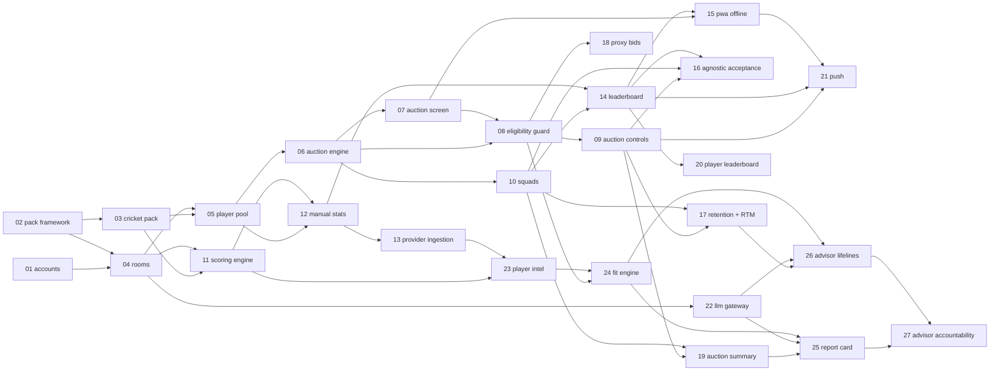

# Roadmap

Build order for every P0 and P1 feature in `docs/PaddleUp_PRD.md`. Each row is an rx spec with a
pre-seeded `specs/<id>/state.md` (intake filled from the PRD, phase `requirements`). The number in the
id is the build order: every feature depends only on features with a lower number, so building them
in order never hits a missing dependency. Live progress is in each `state.md` (or `/rx:status --all`).

## Starting a feature

The spec folder already exists, so do not run `/rx:feature` (it refuses existing ids). Instead:

1. Check its dependencies below are merged to `main`.
2. Review the intake lines in `specs/<id>/state.md` and edit them if the scope changed.
3. `git switch -c feature/<id> main`, then `/rx:next`. The pm drafts `requirements.md` from the intake.

## P0: MVP (no AI)

| # | Feature | PRD scope | Server module | Depends on |
|---|---|---|---|---|
| 01 | accounts | FR-1, FR-2 | accounts | - |
| 02 | sport-pack-framework | FR-140..143, NFR-12 | packs | - |
| 03 | cricket-t20-pack | §7, FR-72 | packs (data) | 02 |
| 04 | rooms | FR-10..13, FR-15 | rooms | 01, 02 |
| 05 | player-pool | FR-20..22 | rooms, packs | 03, 04 |
| 06 | auction-engine | FR-40..43, 45, 48, 50; NFR-1, 2, 4 | auction | 05 |
| 07 | auction-screen | FR-40, 41, 110..112 | web | 06 |
| 08 | eligibility-guard | FR-44 | auction | 06, 07 |
| 09 | auction-controls | FR-46..48 | auction | 08 |
| 10 | squads | FR-60 | rooms | 06 |
| 11 | scoring-engine | FR-70..72 | scoring | 03, 04 |
| 12 | manual-stat-entry | FR-81, NFR-5 | scoring | 05, 11 |
| 13 | provider-ingestion | FR-80, 83, 142 | scoring, packs | 12 |
| 14 | leaderboard | FR-82, 90, 91 | scoring | 10, 12 |
| 15 | pwa-offline | FR-111 | web | 07, 14 |
| 16 | agnostic-acceptance | NFR-12 (P0 exit) | tests | 09, 10, 14 |

## P1: season-ready (AI in PRD order: Player Intel, Fit Engine, Report Card, lifelines)

| # | Feature | PRD scope | Server module | Depends on |
|---|---|---|---|---|
| 17 | retention-rtm | FR-30..32, FR-49 | rooms, auction | 09, 10 |
| 18 | proxy-bids | FR-51 | auction | 08 |
| 19 | auction-summary | FR-52 | auction, rooms | 09, 10 |
| 20 | player-leaderboard | FR-92 | scoring | 14 |
| 21 | push-notifications | FR-100 | decided in plan | 09, 14, 15 |
| 22 | llm-gateway | FR-130, 131; NFR-11 | advisor | 04 |
| 23 | player-intel | FR-120 | scoring | 11, 13 |
| 24 | fit-engine | FR-121 | advisor | 08, 23 |
| 25 | report-card | FR-126 | advisor | 19, 22, 24 |
| 26 | advisor-lifelines | FR-122..125, FR-129 | advisor, auction | 17, 22, 24 |
| 27 | advisor-accountability | FR-127 | advisor | 25, 26 |

Ids are `2026-11-02-<#>-<feature>`, for example `2026-11-02-06-auction-engine`.

## Dependency graph

## Not yet specced (P2 and future)

Create these with `/rx:feature <name>` when their time comes; they get a fresh date id.

- P2: profile stats (FR-3), multi-season carry-over and mini auctions (FR-14), mid-season
  replacements (FR-61), trades (FR-62), captains/multipliers (FR-73), live in-match scoring (FR-84),
  season awards (FR-93), auction chat and reactions (FR-101), report card re-grades (FR-128),
  spectators.
- Future: more Sport Packs (football, basketball, kabaddi), each with zero core code changes.
